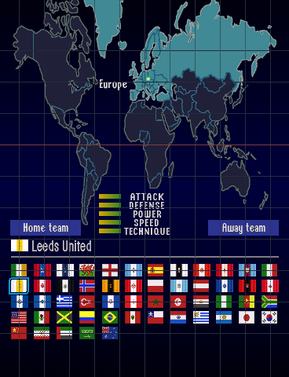
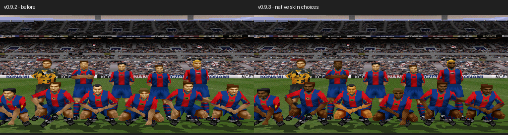

# MATCHDAY 99 v0.9.3

[**Leeds United + ten tonları yamasını indir**](https://github.com/necaticturk-rwf/matchday99/raw/refs/heads/matchday99-v09-downloads/teslim/v0.9.3/MATCHDAY99_v09_3_LEEDS_TEN_YAMASI.zip)

ZIP'i **Tümünü ayıkla** ile çıkarıp **KUR_V09_3.cmd** dosyasına çift tıkla. Python 3 ve daha önce kullandığın `py` başlatıcısı yeterlidir. Kurucu `Masaüstü/ePSXe205/roms/MATCHDAY99_v09_2` klasörünü otomatik arar; bulamazsa mevcut oyun klasörünü seçmeni ister. Oyun klasörünü `.cmd` dosyasının üzerine sürüklemek de mümkündür.

Kurulum ayrı bir klasöre yapılır ve kaynak dosyalar korunur. İşlem sonunda ePSXe'yi yeniden açıp **ISS Pro Evolution - MATCHDAY99_v09_3.cue** dosyasını seç. Eski save state yükleme; önceki sürümün RAM verisini geri getirir.

- Leeds United, kendi yuvasındaki eski Czech Republic etiketinin yerini aldı; diğer kulüp adları değişmedi.
- 440 oyuncu kaydı denetlendi; 439 Transfermarkt portresi incelendi. Oyunun dört mevcut Skin A/B/C/D seçeneğinden 217 oyuncunun seçimi güncellendi. Fotoğrafı olmayan Everton kalecisi Fraser Barnsley'nin tonu korundu. Tonlar fotoğraf ışığı ve dört seçenek sınırı nedeniyle yaklaşık eşleşir.
- Oyuncu isimleri, numaraları, mevkileri, puanları ve ten dışındaki görünüm alanları korundu. v0.9.2'nin 40 forması ve v0.9.1'in bayrak/oyuncu dokusu düzeltmesi aynıdır.
- PCSX-ReARMed ile 20 kulüpte seçim, takım fotoğrafları ve maç başlangıcı denendi; 440 ten alanı oyun RAM'inde, 40 forma doku/paleti menü ve maçta doğrulandı. ePSXe bu Linux ortamında test edilmedi.
- Kurucu v0.8, v0.9, v0.9.1 ve v0.9.2 dosyalarını SHA-256 ile tanır; dört kaynaktan aynı çıktıyı ürettiği sınandı. Windows başlatıcısı ve klasör penceresi burada çalıştırılmadı.

[Ayrıntılı kurulum ve test raporu](OKU_ONCE.txt) · [Oyuncu başına kaynak/ton denetimi](OYUNCU_TEN_DENETIMI.json) · [İkili dosya kontrolleri](binary-validation.json) · [Emülatör kontrolleri](emulator-validation.json) · [Kurucu kontrolleri](installer-validation.json)

[20 kulübün iç saha/deplasman emülatör fotoğrafları](20-clubs-skin-emulator.png)

Yeni Track 01 SHA-256: `c7c4186c609d21181c9586ba9cd18b27d6a855e44a191b3aefa895a80d20b7b6`.

Paket tam oyun içermez. Mevcut oyuna tekrarlanabilir BPS yaması uygular, 11 ses parçasını doğrulayarak kopyalar ve emülatörde açılabilir BIN/CUE üretir.
