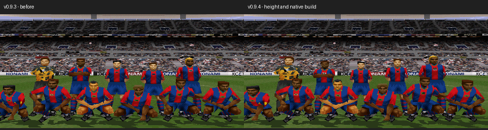

# MATCHDAY 99 v0.9.4

[**Boy ve vücut tipi güncellemesini indir**](https://github.com/necaticturk-rwf/matchday99/raw/refs/heads/matchday99-v09-downloads/teslim/v0.9.4/MATCHDAY99_v09_4_BOY_KILO_YAMASI.zip)

ZIP'i **Tümünü ayıkla** ile çıkarıp **KUR_V09_4.cmd** dosyasına çift tıkla. Kurucu mevcut v0.9.3/v0.9.2/v0.9.1/v0.9/v0.8 oyununu SHA-256 ile tanır ve ayrı klasöre doğrulanmış BIN/CUE oluşturur. Mevcut dosyaları korur. Python 3 ve daha önce kullandığın `py` başlatıcısı yeterlidir. Bulunamazsa oyun klasörünü seç veya `.cmd` dosyasına sürükle.

Sonra ePSXe'yi yeniden başlatıp **ISS Pro Evolution - MATCHDAY99_v09_4.cue** dosyasını aç. **Eski save state yükleme**; önceki sürümün oyuncu verilerini RAM'e geri getirir.

## Uygulanan veriler

| Alan | Kaynaklandırılan | Oyundaki değişiklik |
| --- | ---: | ---: |
| Boy | 439 oyuncu | 418 cm değeri değişti; 21 değer zaten uygundu |
| Kilo / vücut tipi | 431 oyuncu | 327 A–H seçimi değişti; 104 seçim zaten uygundu |

Oyunda boy 155–210 cm aralığındadır. **Sayısal kg alanı yoktur; kilo A–H arasında sekiz vücut tipiyle yaklaşık temsil edilir.** Kütle/boy² oranına en yakın merkez seçildi: A=20, B=21, C=22, D=23, E=24, F=25, G=26, H=27; uçlar sınırlandırılır. Bu bir oyun görünümü uyarlamasıdır. Kaynak kilo ve oyun tipi tabloda ayrı gösterilir.

Boy için Transfermarkt; kilo için resmî Premier League profilleri (408 oyuncu) ve kimliği doğrulanmış ESPN (23 oyuncu) kullanıldı. ESPN'nin lb verileri kg'a çevrildi. Çelişkilerde boy için Transfermarkt, kilo için Premier League önceliklidir; tüm sağlayıcı değerleri denetim JSON'unda korunur. Bunlar yayımlanmış profil bilgileri olup yeni tartım sonucu değildir.

Doğrulanamayan **dokuz kilo için önceki vücut tipi korundu**: Sean Steur, Charlie Hughes, Jens Hjertø-Dahl, Konstantinos Tzolakis, Kaine Kesler-Hayden, Fraser Barnsley, Jules Ahoka, Charalampos Kostoulas, Malick Yalcouyé. Barnsley'nin boyu da doğrulanamadığından korundu. Bazı kaynaklar kilo yayımlamıyor; Hughes/Ahoka ESPN doğum tarihleri uyuşmuyor. Ek kulüp sitelerine istekler ağ geçidinde 403 ile engellendi; gerekli alan adları ortam ağ taslağına kaydedildi ve etkinleşmeleri için ortam ayarlarında kaydetme/yayımlama gerekiyor.

[**440 oyuncunun Excel tablosu**](OYUNCU_BOY_KILO.csv) · [Oyuncu başına kaynak ve önceki/yeni değerler](OYUNCU_BOY_KILO_DENETIMI.json)

## Koruma ve testler

- v0.9.3'e göre yalnız boy/vücut tipi bitleri ve ilgili 5 CD sektörünün EDC/ECC değerleri değişti. Diğer 244 ISO dosyası ve 11 ses parçası aynı.
- Ten renkleri, Leeds United adı, bayrak/doku düzeltmeleri, 40 forma, 440 oyuncunun isim/numara/mevki/puanları ve diğer görünüm alanları korundu.
- PCSX-ReARMed/HLE BIOS/yazılım GPU ile yeni CUE baştan açıldı. 20 kulüpte 440 tam özellik kaydı oyun RAM'inde doğrulandı. Her kulüp için iç saha/deplasman fotoğrafı ve maç başlangıcı alındı; 40 forma doku/paleti ve v0.9.3 yüz/saç atlası kontrolleri geçti.
- Kurucu beş kaynak sürümden aynı doğrulanmış çıktıyı üretti. Dolu klasör, bozuk yama ve eksik ses durumları da sınandı.
- Windows başlatıcısı/klasör penceresi, ePSXe ve gerçek PlayStation burada test edilmedi.

[Ayrıntılı kurulum ve rapor](OKU_ONCE.txt) · [Kaynak doğrulaması](source-validation.json) · [İkili dosya kontrolü](binary-validation.json) · [Emülatör](emulator-validation.json) · [Kurucu](installer-validation.json)

[20 kulübün iki formayla takım fotoğrafları](20-clubs-measurements-emulator.png) · [A–H doğal vücut tipi karşılaştırması](native-builds-same-pose.png)

Yeni Track 01 SHA-256: `1fc70cd075a00da1030a06143c4efa246d9df713c0e4467400666280aafe9504`.

Bu paket tam oyun içermez; mevcut oyuna tekrarlanabilir BPS yaması uygulayarak emülatörde açılabilir BIN/CUE oluşturur.
