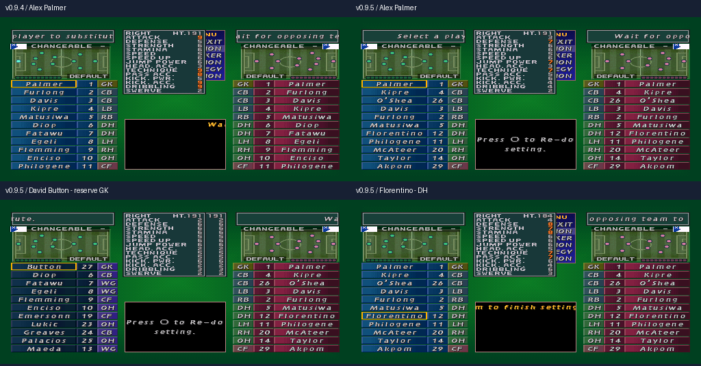

# MATCHDAY 99 v0.9.5

[**Mevki ve yetenek düzeltme yamasını indir**](https://github.com/necaticturk-rwf/matchday99/raw/refs/heads/matchday99-v09-downloads/teslim/v0.9.5/MATCHDAY99_v09_5_MEVKI_YETENEK_YAMASI.zip)

ZIP'i **Tümünü ayıkla** ile çıkarıp **KUR_V09_5.cmd** dosyasına çift tıkla. Kurucu mevcut oyunu SHA-256 ile tanır; kaynakları koruyarak ayrı klasörde doğrulanmış BIN/CUE oluşturur. v0.9.4/v0.9.3/v0.9.2/v0.9.1/v0.9/v0.8 desteklenir. Oyun bulunamazsa mevcut oyun klasörünü `.cmd` dosyasına sürükle veya açılan pencerede seç.

ePSXe'yi yeniden başlatıp **ISS Pro Evolution - MATCHDAY99_v09_5.cue** dosyasını aç. **Eski save state yükleme.**

David Button Ipswich'in yedek kalecisi, Florentino ön libero (DH) olarak düzeltildi. Alex Palmer'ın kaleciye uygun olmayan hücum/şut/teknik profili giderildi. Tottenham, Coventry, Sunderland ve Forest'ta saha oyuncusunun kaleye yerleşmesine yol açan varsayılan sıralama düzeltildi.

20 kulübün 440 oyuncusu kontrol edildi: **19 mevki ve 62 yetenek profili** güncellendi. 45 gerçek kaleci ve hatalı mevkilerden etkilenen saha oyuncuları bu kapsamdadır. İlk 11'ler mevcut dizilişlerin görevlerine uygun sıralandı; yedek kaleci her takımda ilk yedekte. İsim ve tüm özellik kaydı birlikte taşındı; oyuncu eklenmedi, silinmedi veya başka kulübe aktarılmadı.

Boy, vücut tipi, ten rengi, yüz/saç, yaş, forma numarası ve diğer kişisel alanlar oyuncu kimliğiyle birlikte korundu. 40 forma, bayrak/doku düzeltmeleri ve Leeds adı korundu. Mevkiler kayıtlı Transfermarkt/PL verileriyle karşılaştırıldı. **Yetenekler 2–9 oyun ölçeğinde editöryal dengelemedir; resmî kaynak puanları değildir.**

[**Güncel Excel: 20 takım, 440 oyuncu, mevkiler ve yetenekler**](MATCHDAY99_v09_5_Premier_League_20_Takim.xlsx) · [Eski/yeni değişiklikler](MEVKI_YETENEK_DEGISIKLIKLERI.csv) · [Ayrıntılı rapor ve kurulum](OKU_ONCE.txt)

PCSX-ReARMed'de yeni CUE baştan açıldı; 440 tam kayıt canlı RAM'de doğrulandı. 20 takımda ilk 11, iki formayla takım fotoğrafları ve maç başlangıçları kontrol edildi. Altı kaynak sürümden kurulum aynı doğrulanmış çıktıyı verdi. **ePSXe ve Windows başlatıcısı burada test edilmedi.**

[İkili dosya kontrolü](binary-validation.json) · [Kaynaklar](source-validation.json) · [Emülatör](emulator-validation.json) · [Kurucu](installer-validation.json) · [Excel doğrulaması](excel-validation.json)

[Önce/sonra: 5 takımın ilk 11'i](MEVKILER_ONCE_SONRA.png) · [20 takımın düzeltilmiş ilk 11'i](20-clubs-corrected-XI.png) · [40 takım fotoğrafı](20-clubs-positions-emulator.png)

Yeni Track 01 SHA-256: `3ee7a4b881aad442d239a67a0612bad0df63f5435f82a4732e02378d7604f5ab`.

Paket tam oyun içermez; mevcut oyuna uygulanabilen BPS yamalarıyla emülatörde açılabilir BIN/CUE üretir.
